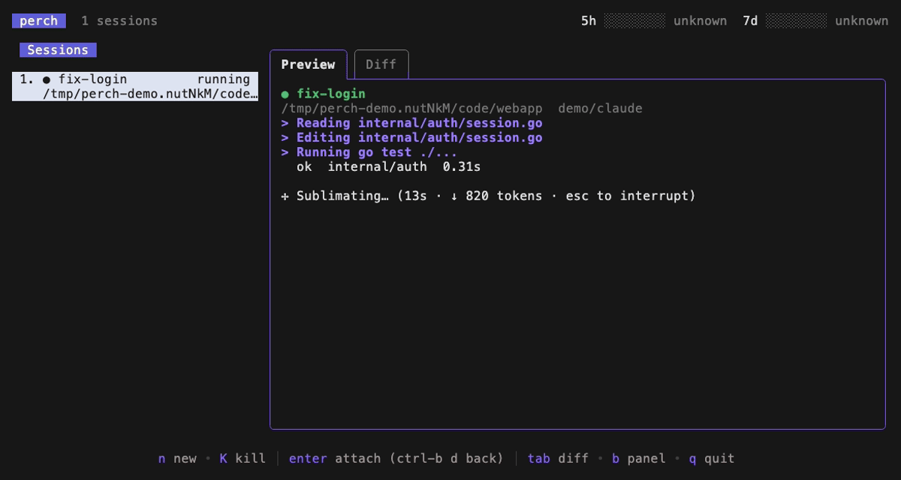

<div align="center">

# perch

**One terminal screen for all your Claude Code sessions.**

See which ones are running, which wait for you, and what each one changed. Jump in with `enter`, jump out with your tmux prefix.


</div>



## Why perch

- **One list, live status.** `●` running · `!` needs input · `○` idle · `◐` attached in another terminal tab. Readable without color.
- **Live preview and diff.** Watch a session work, or switch to the `git diff` of its folder.
- **Sandboxed by default.** Every session is `nono run --name <session> --profile <p> -- claude`.
- **Sessions outlive perch.** Each one is a tmux window. `q` quits perch only.
- **Picks up existing sessions.** Any running nono session shows up, not only perch's own.
- **Rate limits in the header.** 5h and 7d usage bars, plus an optional DeepSeek balance.
- **Worktrees in one tick.** Start a session on a new branch without leaving the dialog.

## Quick start

```sh
go install github.com/rmencattini/perch/cmd/perch@latest   # installs to ~/go/bin
perch
```

From a clone: `go build -o ~/.local/bin/perch ./cmd/perch`.

Run `perch` in a plain terminal or inside tmux. Inside tmux, `enter` opens the session in a popup and your prefix + `d` closes only the popup.

### Requirements

| Tool | Needed for |
|---|---|
| `tmux` | the session windows |
| `nono` | the sandbox every session runs in |
| `claude` | Claude Code itself |
| `fzf` | the folder picker (`ctrl+f`) |
| `secret-tool` | optional, Linux only: the DeepSeek key lookup |

Works on macOS and Linux.

## Keys

| Key | Does |
|---|---|
| `j` `k` / arrows | move |
| `enter` | attach (your tmux prefix + `d` returns to perch; in tmux it opens a popup) |
| `n` | new session dialog |
| `K` | kill: asks, then `nono stop <name>` and drops the window. Only this stops a session |
| `tab` | switch the panel between Preview and Diff |
| `b` | show / hide the panel |
| `q` | quit (sessions keep running) |

Mouse: click a row to select it.

The key to come back is **your own tmux prefix**. It is shown in the key bar and in the popup title, e.g. `ctrl-a d`.

## New session

Press `n`. The exact command is shown before you press `enter`. That is what runs.

| Field | Does |
|---|---|
| **Name** | letters, digits, `. _ -`. Must be unique |
| **Folder** | `ctrl+f` opens fzf over your recent folders and the git repos under `git_root`. It also opens by itself when you tab onto an empty Folder. You can still type a path (`~` works, `tab` completes) |
| **Also allow** | more folders for the same session. `enter` adds one, `backspace` on empty text removes the last. Each gets `--allow <dir>` on nono and `--add-dir <dir>` on claude. Empty text + `enter` creates |
| **Profile** | `←` `→`. The list comes from `nono profile list` |
| **Worktree** | `space` to tick. Makes `<worktree_root>/<repo>/<branch>` (branch created if missing) |

## Config

Optional. `perch` works with no config file.

File: `~/.config/perch/config.json` (`$XDG_CONFIG_HOME/perch/config.json` when set). Keys you leave out keep the defaults in [`internal/config/config.default.json`](internal/config/config.default.json), which is built into the binary. Copy that file as a template.

```json
{
  "default_profile": "my-org/claude",
  "git_root": "~/code",
  "deepseek": { "enabled": true }
}
```

| Key | Default | What |
|---|---|---|
| `default_profile` | `""` | Profile preselected in the new-session dialog. Empty: the first nono profile with `claude` in its name |
| `git_root` | `~/git` | Repos listed by the fzf folder picker |
| `worktree_root` | `<git_root>/worktrees` | Where the Worktree option creates `<repo>/<branch>` |
| `deepseek.enabled` | `false` | Show the DeepSeek balance in the header |
| `deepseek.keychain_service` | `perch` | Keyring item service of the DeepSeek key |
| `deepseek.keychain_account` | `deepseek_api_key` | Keyring item account |

`config.json` is in `.gitignore`: keep your own copy out of the repo.

## Usage bars

The header shows the 5h and 7d rate limits. Claude Code has to feed them to perch.
Add this to `~/.claude/settings.json` **yourself** (perch never edits it):

```json
"statusLine": { "type": "command", "command": "perch statusline" }
```

Already have a statusLine? Keep it and let perch listen:

```json
"statusLine": { "type": "command", "command": "perch statusline --wrap '<your command>'" }
```

- `perch statusline` writes `~/.cache/perch/usage/<session_id>.json` and prints `5h 42% · 7d 10%`.
- No data, or a window that has already reset, shows `unknown` with an empty gray bar. Never `0%`.
- Sessions run inside nono. perch adds `--allow ~/.cache/perch/usage` and `--read <folder of the perch binary>` to the command, so the script can run and write. A profile that denies them breaks the bars.

<details>
<summary><b>DeepSeek balance (optional header item)</b></summary>

<br>

Off by default. Set `"deepseek": { "enabled": true }` in the config file and the header shows `DeepSeek 110.00 CNY` before the usage bars. perch looks for the key in this order:

1. the `DEEPSEEK_API_KEY` environment variable of the shell that starts perch;
2. the system keyring item with the service and account from the config (`deepseek.keychain_service`, `deepseek.keychain_account`):
   - macOS: `security find-generic-password -s <service> -a <account> -w` (macOS may ask once to allow access);
   - Linux: `secret-tool lookup service <service> account <account>`. Store it with `secret-tool store --label=perch service <service> account <account>`.

   Env overrides for the item: `PERCH_DEEPSEEK_KEYCHAIN` (service), `PERCH_DEEPSEEK_KEYCHAIN_ACCOUNT` (account).

How it behaves:

- perch asks `GET https://api.deepseek.com/user/balance` (free, uses no credit) at most every 5 minutes, in the background.
- The key is sent only as that request's `Authorization: Bearer` header. It is never printed, logged or saved.
- Header text: `DeepSeek: no key` none found · `DeepSeek …` loading · `DeepSeek ?` request failed or 401 · `DeepSeek empty ✗` 402 or `is_available: false`.
- `perch balance` prints where the key was found (never the key) and the balance in words. Run it when the header looks wrong.
- This runs in perch itself, not in the nono sessions, so it needs no `--allow` or network rule.

</details>

<details>
<summary><b>Existing sessions</b></summary>

<br>

perch lists every running nono session (`nono ps --json`), not only its own tabs.

- A `◐ other tab` row is held by another terminal: `enter` runs `nono detach <name>` there first (that terminal gets its shell back), then attaches here.
- `K` on either runs `nono stop`.

A session does not show up? Run `perch ps` and look at what it reads.

</details>

<details>
<summary><b>Preview and Diff panel</b></summary>

<br>

The right panel has two tabs, switched with `tab`. It opens on **Preview**.

- **Preview** is the live pane of the session.
- **Diff** is `git diff HEAD` of the session folder plus its untracked files (first 400 lines). A folder that is not a git repo shows "no changes".

</details>

<details>
<summary><b>Files perch uses</b></summary>

<br>

| Path | What |
|---|---|
| `~/.config/perch/config.json` | your settings (optional, see Config) |
| `~/.config/perch/state.json` | recent folders, session info. No secrets |
| `~/.cache/perch/usage/` | rate-limit snapshots |
| `<worktree_root>/<repo>/<branch>` | worktrees |

`$XDG_CONFIG_HOME` and `$XDG_CACHE_HOME` are honoured.

</details>

## Commands

| Command | Does |
|---|---|
| `perch` | open the screen |
| `perch statusline [--wrap '<cmd>']` | the Claude Code statusLine hook (see Usage bars) |
| `perch ps` | show raw `nono ps --json` and what perch makes of it |
| `perch balance` | debug the DeepSeek balance |

## Develop

```sh
go vet ./... && go test ./...
```

Tests never touch your tmux (private `tmux -L` sockets) and never run real `nono` or `claude`.

## Inspiration

The layout (session list on the left, preview and diff on the right) is inspired by [claude-squad](https://github.com/smtg-ai/claude-squad).

## License

[The Unlicense](LICENSE): public domain. Copy it, change it, sell it, no strings.
